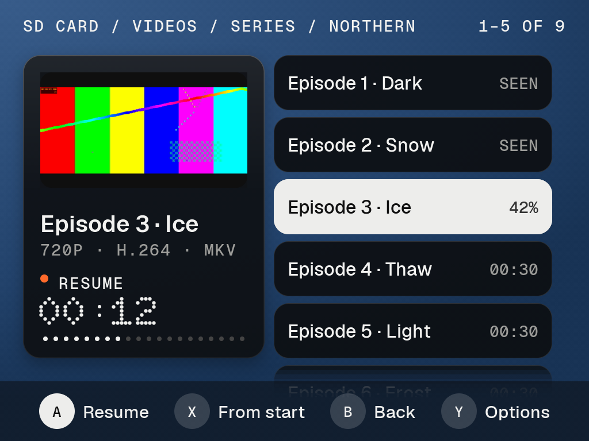
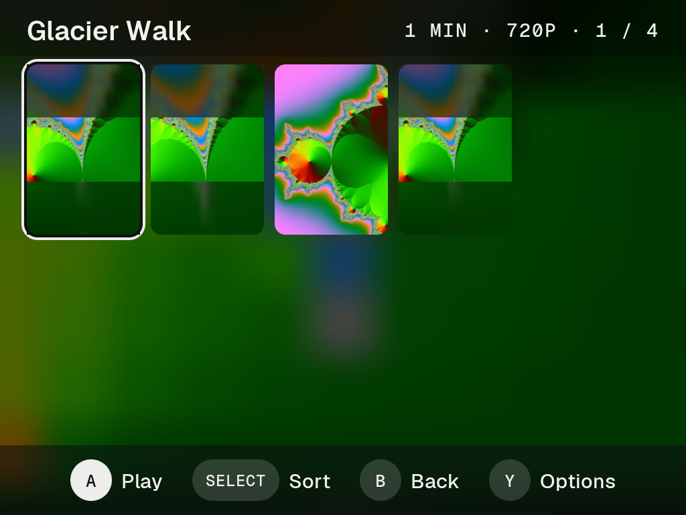
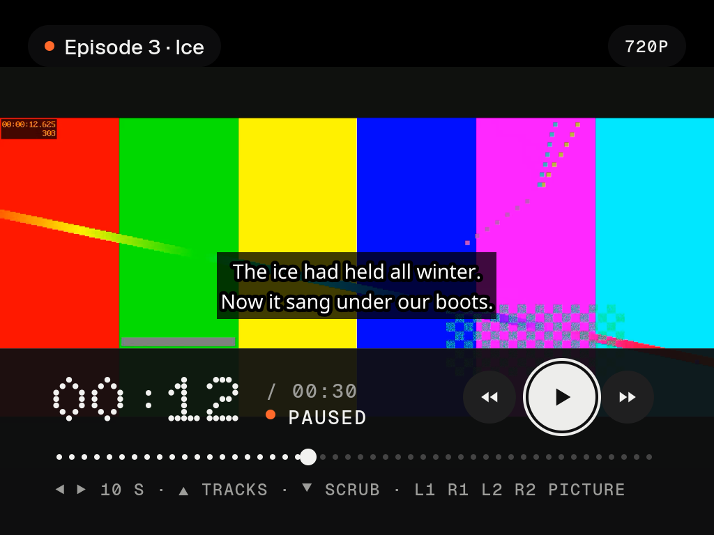
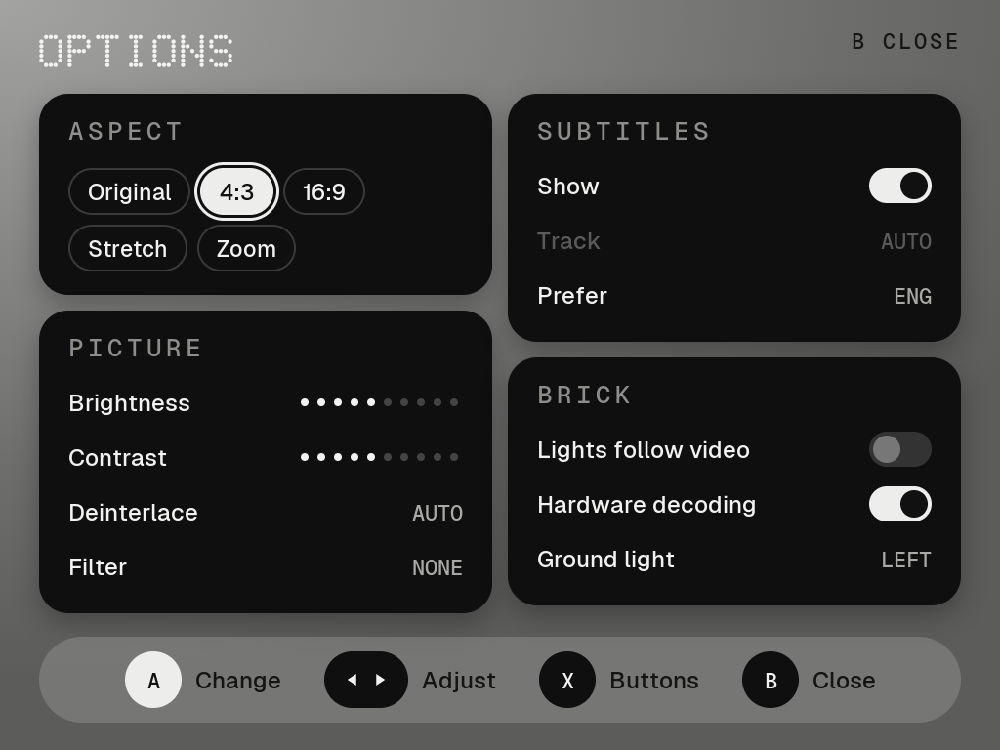
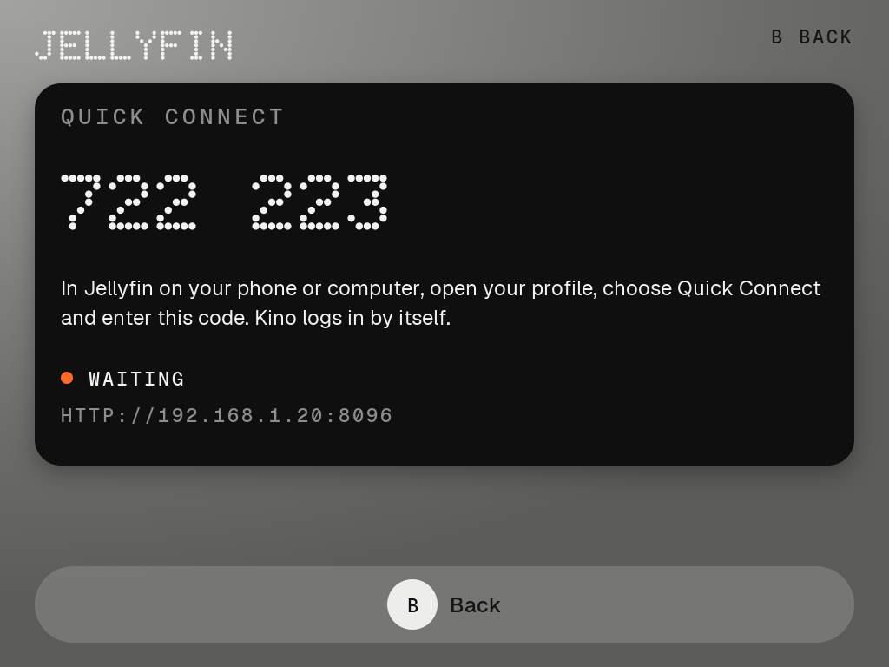
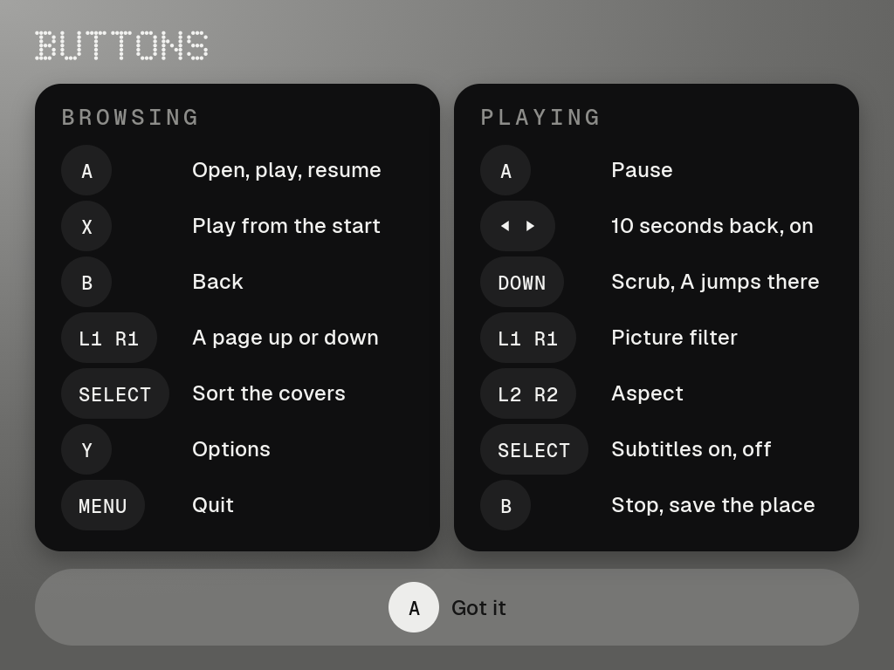

# Kino – video player for NextUI

Plays films and series on the TrimUI Brick (`tg5040`), from the SD card's `Videos` folder or from a
[Jellyfin](https://jellyfin.org) server on the home network. Drawn with [Dot](https://github.com/evolver79/nextui-dotui),
the shared look of Kino, Musicdisk and Tuner.

*Kino* is the word for cinema in Norwegian, as in German, Swedish, Danish, Russian and many other languages. It comes
from the Greek *kínēma*, movement, by way of the cinematograph.

<p>






</p>

Screens rendered headless from the app with test clips (`build/shots.sh`).

- **Hardware decoding:** H.264 and 8-bit HEVC up to 1080p play on the Brick's video engine (Allwinner CedarC, through
  an FFmpeg decoder in `src/cedar`), about one CPU core at 24 fps. Everything else decodes in software.
- **SD card:** folders and files as rows with a picture and the facts of the selected one (length, resolution, codec).
  A folder of films shows as covers instead: a picture next to the film (`Film.jpg`, `Film-poster.jpg`, or
  `poster.jpg` / `folder.jpg` in a film's folder), otherwise the best of four frames from the film.
- **Resume:** Kino remembers where you stopped. A resumes, X plays from the start; nearly finished counts as seen.
- **Jellyfin:** finds the server on the network and logs in with Quick Connect (a code you approve in the Jellyfin
  app). Continue watching and Next up first, films and series as a cover grid, seasons and episodes as rows. Plays
  directly when the Brick can, otherwise the server converts it. Progress is reported back to the server.
- **Streaming over Wi-Fi:** Jellyfin quality in Options sets the most the server may send (2, 4 or 8 Mbit/s, or
  max; 4 by default, plenty for the screen and light on the Brick's 2.4 GHz Wi-Fi); bigger files are converted to
  fit. A pill at the top shows when a film is buffering or waiting for the server, with a note when the Wi-Fi is
  weak. When the stream breaks off, Kino reconnects and carries on where it was (five tries); if that fails it goes
  back to the list with your place kept. Wi-Fi power saving is off while a Jellyfin film plays.
- **While playing:** picture filters (sharpen, warm, cool, black & white, retro CRT), aspect (original, 4:3, 16:9,
  stretch, zoom, or no bars: the film's own black bars cut away, so only pure black surrounds the picture), brightness
  (it keeps black black), contrast, deinterlacing, subtitles (in Noto Sans, four sizes, from the film, a file next to
  it or Jellyfin) with a preferred language, and the Brick's lights can follow the colour of the picture.

## Buttons

| | Browsing | Playing |
|---|---|---|
| A | open, play, resume | pause |
| B | back (quit at the top) | stop and save the place |
| X | play from the start | |
| Y | options | options |
| ◄ ► | a page (rows) or move (covers) | 10 seconds back, forward |
| ▼ | | to the progress bar to scrub; A jumps there |
| L1 / R1 | a page | picture filter |
| L2 / R2 | | aspect |
| SELECT | sort the covers: name, recently added, unwatched | subtitles on/off |
| MENU | quit | quit (the place is saved) |

In Options, X shows the buttons screen (it also opens on the first start).

## Install

Copy `Kino.pak` into `Tools/tg5040/` on the SD card and put videos in `Videos/`. Settings, resume positions and the
picture cache are kept in NextUI's user data folder (`.userdata/tg5040/Kino`). Kino starts in `Videos`; B there goes
up to the SD card, where every folder shows (B at the SD card quits).

## Problems?

Open an [issue](https://github.com/evolver79/nextui-kino-pak/issues) and attach Kino's log: `.userdata/tg5040/logs/Kino.txt`
on the SD card (the run before is kept as `Kino.prev.txt`, so starting Kino again after a problem doesn't lose it).
It notes what Kino did with the network and the player; Jellyfin keys are cut out of it.

## Build

Needs Docker (an ARM64 Debian bullseye container). `git clone --recursive` (Dot is a submodule in `ui/dot`), then:

```sh
build/build.sh    # fetches the library sources, builds FFmpeg, libass and libmpv once (several minutes), then build/out/kino
build/shots.sh    # renders the screens headless to build/out/shots/*.png
```

Copy `build/out/kino` and `ui/dot/fonts/` into `Kino.pak/`. (`deploy.sh` does that and copies the pak to the Brick
with a small private helper.)

## Licence

Kino's own code is MIT (`LICENSE`). The Kino program you install is built with FFmpeg (with its GPL parts on) and
mpv, which are GPL, so **the program as a whole is GPL 2 or later**. Its source is this repository: `build/fetch.sh`
downloads the exact library versions and `build/deps.sh` builds them. The other libraries have their own free licences:
libass (ISC), FreeType (FreeType License), FriBidi (LGPL 2.1), HarfBuzz (Old MIT) and cJSON (MIT). Every licence is in
`licenses/`, which also goes into the pak, and the fonts (Doto and Geist for the screens, Noto Sans for subtitles) are SIL OFL.

Portions of this software are copyright © 2023 The FreeType Project (www.freetype.org). All rights reserved.
